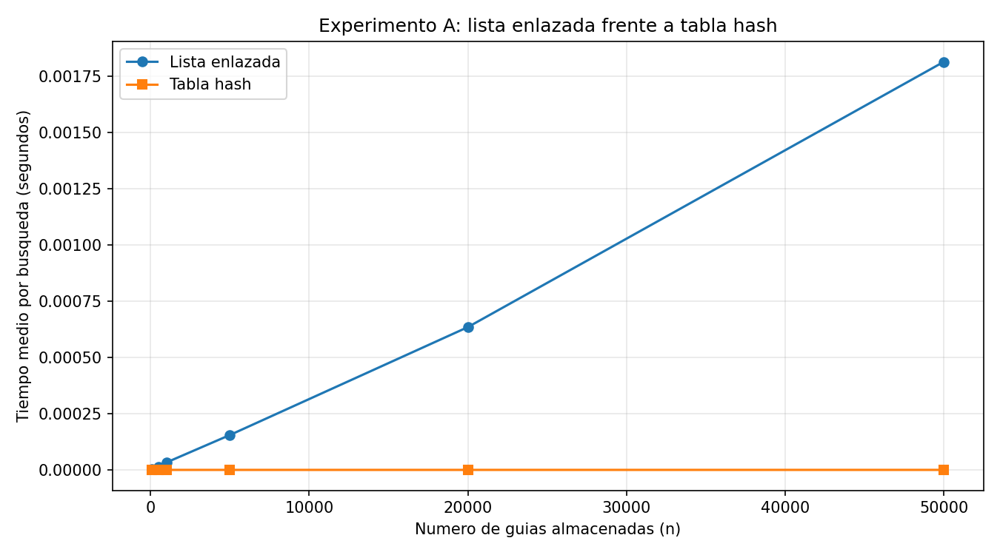
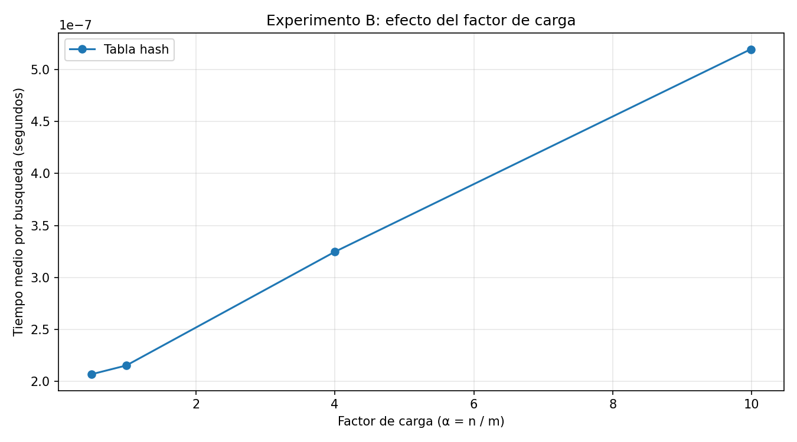

# Curso de Análisis de Algoritmos 2026-1
## Laboratorio evaluativo 03 — Estructuras de datos
### Estudiante: Sofia Villa Muñoz


## Instrucciones para reproducir el experimento
Para reproducir correctamente el entorno del laboratorio, siga los siguientes pasos:

1. Abra una terminal dentro de la carpeta lab3-estructuras-datos y cree el entorno virtual:
### Windows
```bash
    python -m venv venv
    venv\Scripts\activate
```
### Linux / macOS
```bash
    python3 -m venv venv
    source venv/bin/activate    
```

2. Con el entorno virtual activado, instale las dependencias del proyecto mediante el archivo requirements.txt:
```bash
    pip install -r requirements.txt
```

3. Ejecute el archivo pruebas.py para validar el correcto funcionamiento de los métodos:
```bash
    python pruebas.py
```

4. Ejecute el archivo de medicion.py para las mediciones de tiempo y generación de las gráficas:
```bash
    python medicion.py
```
## Parte 1 — Descripción de validación de estructuras y casos cubiertos.

### Código de las estructuras de datos: [estructuras.py](estructuras.py)
### Pruebas: [pruebas.py](pruebas.py)

Para validar las estructuras implementadas, se realizaron diferentes pruebas mediante instrucciones assert, con el propósito de comprobar que la lista enlazada y la tabla hash devolvieran los resultados esperados al consultar las guías de envío.

En primer lugar, se verificaron búsquedas exitosas e infructuosas en ambas estructuras. Para las búsquedas exitosas, se comprobó que cada guía almacenada devolviera su estado correspondiente. Para las infructuosas, se verificó que una guía inexistente devolviera None.

También se evaluó el manejo de colisiones en la tabla hash utilizando m = 7 y las guías 10, 24 y 17. Como las tres producen el índice 3 mediante la función hash por división, se comprobó que pudieran insertarse y buscarse correctamente, que la lista enlazada de esa casilla contuviera tres nodos y que el factor de carga fuera 3 / 7.

Finalmente, se realizaron veinte colecciones aleatorias para comparar los resultados de búsqueda de ambas estructuras. Se verificó que las guías existentes devolvieran el mismo estado en la lista y en la tabla, y que las guías inexistentes no fueran encontradas. Para facilitar la reproducción de las pruebas, se utilizó una semilla fija (42) en la generación de los datos aleatorios, de modo que las colecciones pudieran generarse nuevamente siguiendo la misma secuencia.

## Parte 2 — Medir y graficar
### Código de medición: [medicion.py](medicion.py)

### Experimento A — Lista enlazada frente a tabla hash

Para este experimento se midió el tiempo promedio de búsqueda de guías inexistentes en la lista enlazada y en la tabla hash para seis tamaños de entrada: 100, 500, 1.000, 5.000, 20.000 y 50.000 guías. Para cada tamaño se utilizó un número de casillas m primo y cercano a n / 2, con el propósito de mantener el factor de carga alrededor de 2.

En cada medición se realizaron 200 búsquedas de guías inexistentes, durante cinco repeticiones. Además, se calculó  el tiempo promedio por búsqueda en segundos, utilizando time.perf_counter() para cronometrar únicamente las consultas. Las guías almacenadas se generaron con la semilla 2026, mientras que las guías inexistentes se generaron con la semilla 7. Para cada tamaño se utilizaron las mismas consultas en ambas estructuras.

Los parámetros y resultados obtenidos fueron los siguientes:

| Número de guías (n) | Casillas (m) | Factor de carga (α) | Lista (s/búsqueda) | Tabla hash (s/búsqueda) |
|---:|---:|---:|---:|---:|
| 100 | 53 | 1.887 | 0.00000298 | 0.00000018 |
| 500 | 251 | 1.992 | 0.00001401 | 0.00000020 |
| 1,000 | 503 | 1.988 | 0.00003320 | 0.00000022 |
| 5,000 | 2,503 | 1.998 | 0.00015511 | 0.00000025 |
| 20,000 | 10,007 | 1.999 | 0.00063441 | 0.00000027 |
| 50,000 | 25,013 | 1.999 | 0.00181279 | 0.00000027 |

La siguiente gráfica compara los tiempos medios de búsqueda de ambas estructuras en los mismos ejes.



### Experimento B — Efecto del factor de carga

Para este experimento se mantuvo fijo el número de guías en n = 20.000 y se construyeron tablas hash con diferentes cantidades de casillas. Se utilizaron cuatro factores de carga objetivo: 0,5; 1; 4 y 10. Como m debía ser primo, se registró el factor de carga real obtenido en cada caso.

Se midió el tiempo medio de búsqueda de 200 guías inexistentes durante cinco repeticiones, utilizando las mismas consultas para las cuatro tablas. El cronometraje se realizó con time.perf_counter() y los resultados se expresaron en segundos por búsqueda.

| Factor de carga objetivo | Casillas (m) | Factor de carga real (α) | Tiempo medio (s/búsqueda) |
|---:|---:|---:|---:|
| 0.5 | 40,009 | 0.4999 | 0.00000021 |
| 1 | 20,011 | 0.9995 | 0.00000022 |
| 4 | 5,003 | 3.9976 | 0.00000032 |
| 10 | 2,003 | 9.9850 | 0.00000052 |

La siguiente gráfica muestra la variación del tiempo medio de búsqueda según el factor de carga real de cada tabla.



## Parte 3 — Análisis.

### 1. Costo teórico

En una lista enlazada, la búsqueda de una guía inexistente tiene un costo de Θ(n), porque es necesario recorrer los nodos uno por uno desde la cabeza hasta llegar al final. Como la guía no se encuentra, se deben revisar los (n) nodos antes de concluir que no existe. Por tanto, el tiempo de búsqueda crece proporcionalmente al número de guías almacenadas.

En una tabla hash con encadenamiento, la guía se asigna a una casilla mediante la función hash y la búsqueda se realiza únicamente en la lista enlazada de esa casilla. Su costo promedio es Θ(1 + α), donde (α = n / m) es el factor de carga, con (n) guías almacenadas y (m) casillas. Este resultado supone que la función hash distribuye las guías de manera aproximadamente uniforme entre las casillas. Si todas las guías cayeran en una misma casilla, la lista de esa casilla tendría (n) elementos y la búsqueda de una guía inexistente volvería a costar Θ(n).

### Lo medido contra lo esperado.

En la primera gráfica, al comparar la lista enlazada con n = 20.000 y n = 50.000, el tiempo pasó de 0,00063441 a 0,00181279 segundos por búsqueda, lo que equivale a una multiplicacion aproximada de 2,86, mientras que el número de guías aumentó 2,5 veces. Este resultado se aproxima al crecimiento lineal esperado de Θ(n). En la tabla hash, el tiempo se mantuvo en 0,00000027 segundos por búsqueda para ambos tamaños, lo que concuerda con un comportamiento aproximadamente constante de Θ(1), dado que el factor de carga se mantuvo cercano a 2.

En la segunda gráfica, al aumentar el factor de carga real de aproximadamente 0,5 a 10, el tiempo medio de búsqueda pasó de 0,00000021 a 0,00000052 segundos, un aumento aproximado de 2,48 veces. La tendencia creciente es coherente con Θ(1 + α), aunque el aumento no es proporcional al factor de carga. Esto puede explicarse, en parte, por la variabilidad del cronometraje, dado que los tiempos medidos son muy pequeños.


